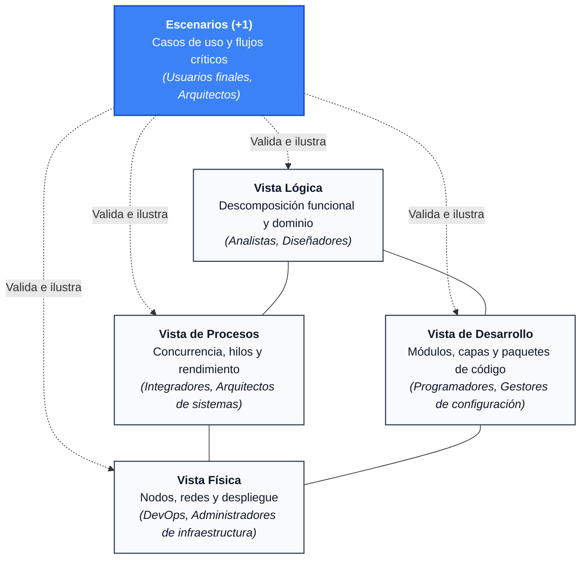

# Fundamentos del Modelo de Vistas 4+1

El **Modelo de Vistas 4+1** es uno de los marcos de trabajo arquitectónicos más influyentes en la ingeniería de software. Propuesto formalmente por **Philippe Kruchten** en 1995 en su célebre artículo *"Architectural Blueprints—The '4+1' View Model of Software Architecture"*, este modelo establece un método riguroso para describir la arquitectura de sistemas intensivos en software mediante múltiples perspectivas concurrentes.

---

## 1. El Problema Fundamental de la Arquitectura

En proyectos de software reales, intentar plasmar la arquitectura en un **único diagrama unificado** conduce invariablemente a dos problemas críticos:

1. **Sobrecarga cognitiva:** El diagrama se satura de cajas, flechas, protocolos, dependencias de código y detalles de red, volviéndose ilegible e inútil.
2. **Conflicto de intereses:** Los distintos participantes del proyecto (*stakeholders*) tienen necesidades radicalmente distintas. A un usuario de negocio no le interesan los hilos del sistema operativo ni la topología de subredes; a un ingeniero de redes no le interesan los patrones de diseño de clases ni los casos de uso secundarios.

> **Definición Clave (IEEE 1471 / ISO/IEC/IEEE 42010):**
> - **Punto de vista (*Viewpoint*):** Marco de trabajo o conjunto de convenciones para construir y usar una vista; define las preocupaciones de un grupo de interesados.
> - **Vista (*View*):** Representación de un sistema concreto desde la perspectiva de un punto de vista específico.

El modelo 4+1 resuelve esta tensión organizando la arquitectura en **cuatro vistas técnicas ortogonales** (cada una centrada en un conjunto específico de preocupaciones) y **una vista integradora (+1)** que valida y une a las demás.

---

## 2. Visión General del Modelo 4+1

---

## 3. Matriz de Vistas y Stakeholders

Cada una de las 5 vistas atiende a una audiencia primaria y responde a interrogantes específicas del ciclo de vida:

| Vista | Interrogante Principal | Audiencia Primaria | Preocupaciones Clave (*Concerns*) | Diagramas Típicos |
| :--- | :--- | :--- | :--- | :--- |
| **Escenarios (+1)** | ¿Qué debe hacer el sistema y cómo se usa? | Usuarios finales, Product Owners, Arquitectos, QA | Requisitos funcionales, validación global, coherencia entre vistas, valor de negocio. | Casos de uso UML, Diagramas de flujo de pasos, Historias de usuario. |
| **Lógica** | ¿Cómo se estructura conceptualmente la solución? | Analistas, Diseñadores, Desarrolladores | Modelo de dominio, entidades, abstracciones, interfaces, patrones de diseño. | Diagramas de clases, diagramas de objetos, máquinas de estado. |
| **Procesos** | ¿Cómo se comporta el sistema en tiempo de ejecución? | Integradores, Desarrolladores backend, Arquitectos de rendimiento | Concurrencia, hilos, procesos, colas, latencia, throughput, sincronización y bloqueos. | Diagramas de secuencia, diagramas de actividad, diagramas de comunicación. |
| **Desarrollo** | ¿Cómo se organiza el código y las dependencias de construcción? | Desarrolladores, Líderes técnicos, Release Managers | Módulos, paquetes, bibliotecas, capas de código, gestión de dependencias y builds. | Diagramas de componentes, diagramas de paquetes, grafos de dependencias. |
| **Física** | ¿Dónde y sobre qué hardware/redes se ejecuta el software? | Ingenieros DevOps, SysAdmins, Arquitectos Cloud | Servidores, máquinas virtuales, contenedores, balanceadores, topología de red, HA. | Diagramas de despliegue, topologías de red en la nube (AWS/Azure/GCP). |

---

## 4. El Papel Crucial del «+1» (Escenarios)

A menudo surge la duda: *¿por qué se llama «4+1» y no simplemente «Modelo de 5 vistas»?*

Kruchten introdujo la distinción deliberadamente:
1. **No es ortogonal a las otras cuatro:** Las cuatro vistas técnicas (Lógica, Proceso, Desarrollo y Física) son ortogonales entre sí, lo que significa que abordan dimensiones independientes del sistema.
2. **Es el pegamento unificador (*Architectural Glue*):** La vista de escenarios selecciona un subconjunto pequeño pero **arquitectónicamente significativo** de casos de uso (los flujos más críticos, de mayor riesgo o de mayor demanda de rendimiento).
3. **Mecanismo de descubrimiento y validación:** 
   - Durante la fase de diseño inicial, los escenarios impulsan el descubrimiento de los elementos en las cuatro vistas técnicas.
   - Durante la fase de revisión, los arquitectos recorren mentalmente (o simulan) los escenarios a través de las otras cuatro vistas para verificar que no existan cuellos de botella, inconsistencias o dependencias circulares.

---

## 5. Principio de Separación de Preocupaciones (*Separation of Concerns*)

El modelo 4+1 aplica de forma estricta el principio de Edsger W. Dijkstra:

- **Independencia relativa:** Un cambio en la vista física (por ejemplo, migrar de servidores dedicados on-premise a clústeres de Kubernetes en la nube) no debería obligar a rediseñar la vista lógica ni los casos de uso.
- **Focalización:** Un desarrollador que implementa una clase puede concentrarse en la vista lógica y de desarrollo sin tener que descifrar las tablas de enrutamiento de red de la vista física.
- **Trazabilidad:** Cada elemento físico o de proceso debe responder en última instancia a una necesidad originada en un escenario de usuario.

---

## 6. Evolución del Modelo en la Era Moderna

Cuando Kruchten formuló el modelo en 1995, predominaban los sistemas monolíticos orientados a objetos, CORBA, C++ y clientes pesados. Hoy, el modelo 4+1 sigue plenamente vigente, adaptándose con naturalidad a los paradigmas contemporáneos:

- **Microservicios y Serverless:** La vista física ahora incluye funciones Lambda, pods efímeros, ingress controllers y service meshes (Istio/Linkerd).
- **Arquitecturas dirigidas por eventos (EDA):** La vista de procesos cobra un protagonismo aún mayor al modelar tópicos Kafka, streams asíncronos y backpressure.
- **Domain-Driven Design (DDD):** Encaja a la perfección con la vista lógica al definir *Bounded Contexts*, agregados, entidades y *Value Objects*.
- **Contenedores y CI/CD:** La vista de desarrollo conecta directamente con pipelines de integración continua, monorrepos y artefactos OCI (imágenes Docker).
