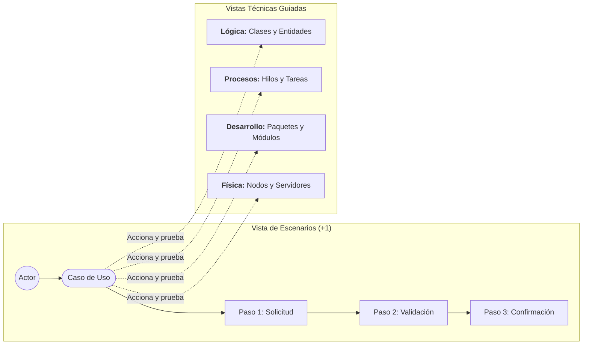
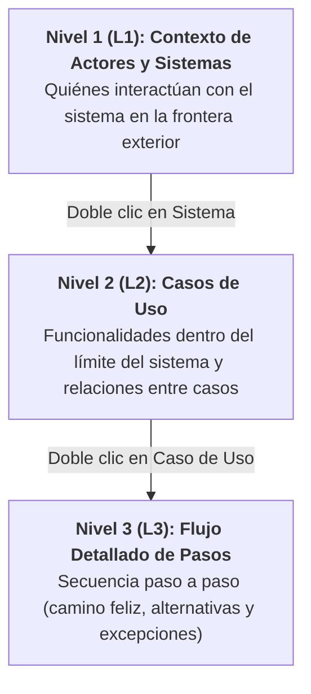

# Vista de Escenarios (+1 View)

La **Vista de Escenarios** (también llamada *Vista de Casos de Uso*) constituye el corazón metodológico del Modelo 4+1 de Kruchten. Representa el componente **«+1»**, actuando como el elemento de cohesión que une, guía y valida las cuatro vistas técnicas restantes.

---

## 1. Propósito y Filosofía del «+1»

A diferencia de las cuatro vistas técnicas (que describen la estructura y comportamiento interno del software), la Vista de Escenarios describe **qué hace el sistema desde la perspectiva de sus usuarios externos y sistemas interactuantes**.

Sus objetivos primordiales son:
1. **Descubrimiento del diseño arquitectónico:** Durante las etapas tempranas, los casos de uso más exigentes revelan las clases necesarias (Vista Lógica), los hilos/procesos requeridos (Vista de Procesos), los módulos a construir (Vista de Desarrollo) y la infraestructura de soporte (Vista Física).
2. **Validación de coherencia:** Funciona como un banco de pruebas de diseño. Un arquitecto toma un escenario y "traza" su ejecución paso a paso a través de las otras cuatro vistas para confirmar que el diseño resuelve el problema sin inconsistencias.
3. **Comunicación interdisciplinaria:** Sirve de puente común entre perfiles no técnicos (product owners, clientes, directores de negocio) y perfiles de ingeniería profunda.

---

## 2. Casos de Uso Arquitectónicamente Significativos (ASUC)

Una regla de oro en el modelo 4+1 es que **la vista de escenarios NO debe documentar el 100% de los casos de uso del sistema**. 

Documentar cada pantalla CRUD trivial (ej. "Editar código postal del usuario") añade ruido y oscurece las decisiones estructurales. En su lugar, el arquitecto debe seleccionar entre un **5% y un 10%** de casos de uso que posean **Significancia Arquitectónica**:

- **Casos de alto riesgo:** Operaciones que involucran transacciones críticas, procesamiento de pagos o sincronización en tiempo real.
- **Casos de alta concurrencia o volumen:** Flujos que pondrán a prueba la escalabilidad y latencia del sistema (ej. pico de tráfico de streaming o subastas).
- **Casos que abarcan múltiples límites de subsistemas:** Flujos que atraviesan varias fronteras de red, protocolos y bases de datos.
- **Casos que definen el núcleo del valor de negocio:** Aquellos que justifican la existencia de la plataforma.

---

## 3. Elementos Fundamentales de la Vista

En un modelador visual para el modelo 4+1, los elementos de la vista de escenarios se dividen en las siguientes entidades canónicas:

| Elemento | Representación Visual | Definición | Ejemplo |
| :--- | :--- | :--- | :--- |
| **Actor** | Icono de persona / figura | Entidad externa que interactúa con el sistema (humana o automatizada). | `Cliente`, `Administrador`, `Pasarela de Pagos Stripe` |
| **Límite del Sistema (*System Boundary*)** | Rectángulo contenedor | Delimita el alcance de la aplicación o subsistema bajo análisis. | `Plataforma de E-commerce CineNova` |
| **Caso de Uso** | Elipse u óvalo | Unidad discreta y observable de funcionalidad que aporta valor a un actor. | `Procesar Suscripción Premium` |
| **Paso de Flujo (*Flow Step*)** | Rectángulo redondeado / bloque de acción | Acción secuencial específica que compone la interacción del caso de uso. | `Validar tarjeta con emisor bancario` |
| **Nota / Anotación** | Bloque post-it con esquina doblada | Comentario explicativo, regla de negocio o consideración no funcional. | *Regla: Tiempo de respuesta < 200ms* |

---

## 4. Jerarquía de Abstracción y Navegación Multinivel (*Drill-Down*)

Para modelar sistemas complejos de forma ordenada y sin saturar la pantalla, la vista de escenarios se estructura típicamente en **tres niveles de profundidad**:

### Nivel 1 (L1) - Actores y Frontera del Sistema
- Identifica a todos los actores primarios (inician el flujo) y secundarios (asisten o son consultados por el sistema).
- Muestra el sistema como una caja negra (*boundary*) con sus conexiones iniciales.

### Nivel 2 (L2) - Desglose de Casos de Uso
- Al "abrir" el sistema (*drill-down*), se observan los casos de uso contenidos dentro de su límite.
- Se trazan las asociaciones de los actores con cada caso de uso específico.
- Se modelan las relaciones avanzadas de casos de uso (véase sección 5).

### Nivel 3 (L3) - Flujo del Caso de Uso (*Scenario Flow*)
- Al "abrir" un caso de uso particular, se revela su dinámica interna estructurada en pasos:
  1. **Camino feliz (*Happy Path*):** Flujo principal de éxito sin desvíos ni fallos.
  2. **Flujos alternativos (*Alternative Flows*):** Caminos válidos secundarios (ej. usuario paga con PayPal en vez de tarjeta).
  3. **Flujos de excepción (*Exception Flows*):** Gestión de errores, caídas de red o validaciones fallidas.

---

## 5. Relaciones Estándar entre Elementos

| Relación | Notación UML | Semántica | Cuándo Usarla |
| :--- | :--- | :--- | :--- |
| **Asociación (*Association*)** | Línea continua sólida | Conexión bidireccional o unidireccional de comunicación entre un Actor y un Caso de Uso. | Siempre que un actor participe activamente en un caso de uso. |
| **Inclusión (`<<include>>`)** | Línea discontinua con flecha abierta hacia el caso incluido | El caso base **requiere obligatoriamente** la ejecución del caso incluido para completarse con éxito. | Para extraer lógica común y reutilizable (ej. `Autenticar Usuario`). |
| **Extensión (`<<extend>>`)** | Línea discontinua con flecha abierta hacia el caso base | El caso que extiende introduce comportamiento **opcional o condicional** en un punto de extensión del caso base. | Para flujos opcionales (ej. `Aplicar Cupón de Descuento` sobre `Realizar Compra`). |
| **Generalización (*Generalization*)** | Línea continua con punta de flecha triangular vacía | Herencia conceptual donde un caso de uso o actor especializado hereda y redefine aspectos del general. | `Pago con Cripto` hereda de `Procesar Pago`. `Supervisor` hereda de `Operador`. |

---

## 6. Metadatos de un Caso de Uso Arquitectónico

Un caso de uso riguroso en el modelo 4+1 debe contener los siguientes metadatos descriptivos en su ficha técnica o inspector:

1. **Identificador único:** Código estandarizado (ej. `CU-01`, `UC-AUTH-03`).
2. **Actor principal:** Quién dispara la interacción.
3. **Precondiciones:** Estado requerido del sistema antes de iniciar (ej. *El usuario debe contar con una sesión activa y un carrito no vacío*).
4. **Postcondiciones de éxito:** Estado garantizado tras finalizar con éxito (ej. *Se descuenta el stock, se genera factura y se emite evento de envío*).
5. **Postcondiciones de fallo:** Estado garantizado si el flujo aborta (ej. *El inventario queda intacto y se registra log de auditoría*).
6. **Requisitos no funcionales asociados:** SLA de tiempo de respuesta, nivel de seguridad requerido o disponibilidad mínima.
