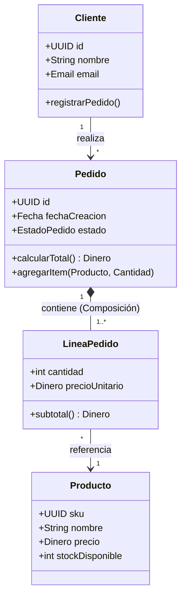

# Vista Lógica (Logical View)

La **Vista Lógica** describe la estructura conceptual y la descomposición funcional del sistema de software. Su objetivo primordial es modelar los conceptos del dominio del negocio y las abstracciones fundamentales de diseño que dan soporte a los requisitos funcionales identificados en la Vista de Escenarios.

---

## 1. Propósito y Audiencia

- **Audiencia:** Analistas de negocio, diseñadores de software, arquitectos y programadores.
- **Pregunta central:** *¿Cómo está modelada la lógica y la estructura funcional del sistema en términos de abstracciones, responsabilidades y relaciones?*
- **Foco:** Independencia de la infraestructura física o de la concurrencia de hilos. Modela el «qué» y el «cómo conceptual», sin atarse a detalles de puertos TCP o contenedores Docker.

---

## 2. Elementos Clave de la Vista Lógica

En el modelado arquitectónico moderno, la vista lógica abarca tanto los elementos orientados a objetos clásicos como los patrones de diseño guiados por el dominio (*Domain-Driven Design - DDD*):

### Catálogo de Entidades y Tipos

| Elemento | Estereotipo UML | Descripción | Responsabilidad / Atributos clave |
| :--- | :--- | :--- | :--- |
| **Clase (*Class*)** | `<<class>>` | Molde o abstracción principal que encapsula estado (atributos) y comportamiento (métodos). | Nombre, atributos tipados, visibilidad (`+`, `-`, `#`), operaciones. |
| **Interfaz (*Interface*)** | `<<interface>>` | Contrato formal de operaciones que desacopla la definición de su implementación. | Métodos abstractos, firmas y parámetros. |
| **Entidad de Dominio (*Entity*)** | `<<entity>>` | Objeto con identidad propia y ciclo de vida persistente (DDD). | ID inmutable, reglas de negocio intrínsecas. |
| **Objeto de Valor (*Value Object*)** | `<<value-object>>` | Objeto inmutable definido exclusivamente por sus atributos, sin identidad propia. | `Dinero`, `Dirección`, `RangoFechas`. |
| **Servicio de Dominio (*Service*)** | `<<service>>` | Operación de negocio que no pertenece naturalmente a ninguna entidad específica. | `CalculadorImpuestos`, `ServicioRuta`. |
| **Subsistema / Módulo Lógico** | `<<subsystem>>` | Agrupación lógica de alto nivel que encapsula un subconjunto coherente de clases. | `Subsistema de Facturación`, `Módulo de Catálogo`. |
| **Enumeración (*Enum*)** | `<<enum>>` | Conjunto fijo de constantes tipadas. | `EstadoPedido`, `TipoMoneda`. |

---

## 3. Relaciones Lógicas y Semántica

Las relaciones en la vista lógica definen cómo interactúan y dependen las abstracciones entre sí:

| Relación | Notación Gráfica | Símbolo UML | Significado y Regla de Vida |
| :--- | :--- | :--- | :--- |
| **Asociación (*Association*)** | Línea sólida con flecha opcional | `A ───> B` | Conexión estructural entre clases. *A conoce o usa a B*. Puede tener cardinalidad (`1..*`, `0..1`). |
| **Dependencia (*Dependency*)** | Línea discontinua con flecha abierta | `A - - > B` | Relación de uso transitorio. Si B cambia, A puede verse afectado (ej. B se recibe como parámetro en un método). |
| **Generalización / Herencia** | Línea sólida con triángulo cerrado vacío | `A ────▷ B` | Relación "es un" (*is-a*). La subclase hereda contratos y atributos de la superclase. |
| **Realización / Implementación** | Línea discontinua con triángulo cerrado vacío | `A - - ▷ B` | Una clase concreta implementa y cumple el contrato definido por una interfaz. |
| **Agregación (*Aggregation*)** | Línea sólida con rombo vacío en el contenedor | `A ◇─── B` | Relación "tiene un" débil. Las partes pueden existir independientemente del todo (ej. *Universidad* y *Profesor*). |
| **Composición (*Composition*)** | Línea sólida con rombo relleno en el contenedor | `A ◆─── B` | Relación de pertenencia fuerte. Si el contenedor se destruye, las partes se destruyen con él (ej. *Factura* y *Líneas de Factura*). |

---

## 4. Patrones Arquitectónicos en la Vista Lógica

La vista lógica debe reflejar claramente el patrón o estilo arquitectónico adoptado por el proyecto:

### A. Arquitectura por Capas (*Layered Architecture*)
Las clases se distribuyen en niveles jerárquicos con dependencias estrictas descendentes:
1. **Capa de Presentación / Controladores:** Recibe solicitudes y presenta resultados.
2. **Capa de Aplicación / Casos de Uso:** Orquesta los flujos de negocio.
3. **Capa de Dominio:** Contiene las entidades, reglas puras y servicios centrales.
4. **Capa de Infraestructura / Persistencia:** Repositorios concretos y adaptadores externos.

### B. Arquitectura Hexagonal / Puertos y Adaptadores (*Clean Architecture*)
El núcleo de negocio (Dominio) permanece en el centro absoluto:
- **Puertos de entrada (*Primary Ports*):** Interfaces para los casos de uso consumidos por la UI o APIs.
- **Puertos de salida (*Secondary Ports*):** Interfaces definidas por el dominio para que la infraestructura las implemente (ej. `RepositorioUsuariosInterface`, `NotificadorSMSInterface`).

---

## 5. Diagramas Típicos Asociados a la Vista Lógica

1. **Diagramas de Clases de Alto Nivel:** Muestran los paquetes principales y sus subsistemas.
2. **Diagramas de Clases Detallados:** Exponen atributos, visibilidades, métodos y cardinalidades de un subconjunto crítico.
3. **Diagramas de Máquina de Estados (*Statecharts*):** Imprescindibles para modelar ciclos de vida complejos de entidades clave (ej. los estados y transiciones de un pedido: `Borrador` $\to$ `Pagado` $\to$ `En Preparación` $\to$ `Despachado` $\to$ `Entregado` / `Cancelado`).
4. **Diagramas de Objetos:** Ilustran instancias concretas en un instante específico de tiempo para explicar un escenario intrincado.
