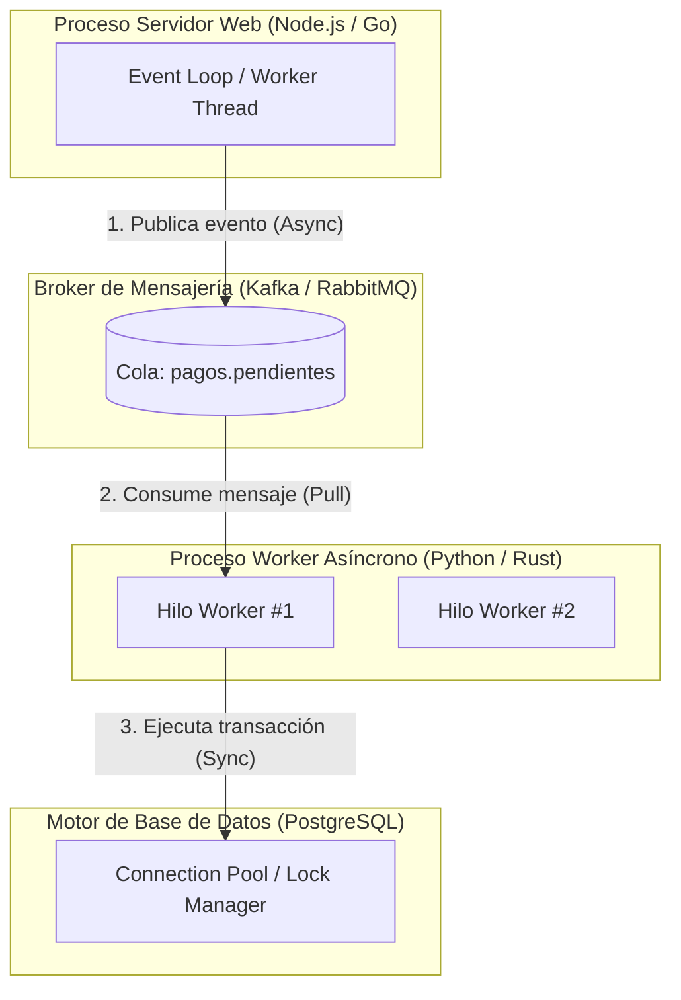
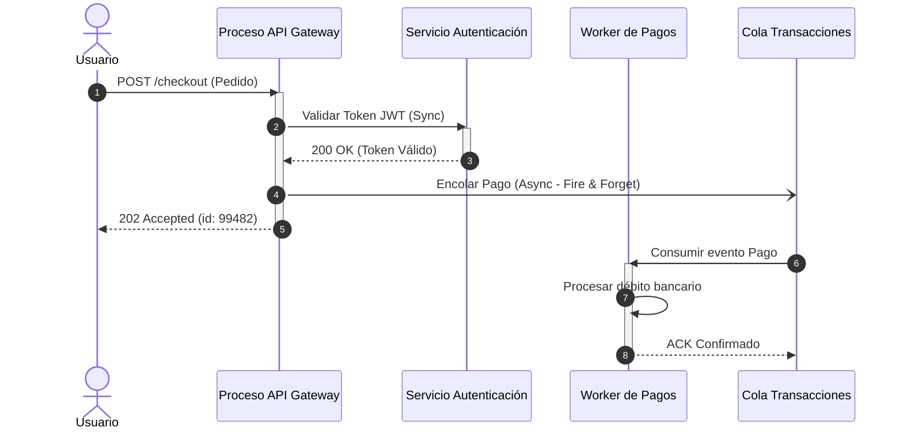

# Vista de Procesos (Process View)

La **Vista de Procesos** aborda los aspectos dinámicos del sistema en tiempo de ejecución. Se enfoca en cómo los componentes de software cobran vida cuando se ejecutan, cómo se distribuye la concurrencia, cómo se comunican las distintas partes y cómo se garantiza el rendimiento y la escalabilidad.

---

## 1. Propósito y Audiencia

- **Audiencia:** Integradores de sistemas, desarrolladores backend, especialistas en rendimiento (*performance engineers*) y arquitectos de soluciones.
- **Pregunta central:** *¿Cómo se comporta el sistema mientras se ejecuta? ¿Cómo maneja la concurrencia, la carga de trabajo masiva, los hilos, la latencia y la comunicación entre procesos?*
- **Foco:** Requisitos no funcionales fundamentales: **rendimiento**, **disponibilidad**, **concurrencia**, **integridad transaccional** y **tolerancia a fallos**.

---

## 2. Conceptos y Elementos Fundamentales

En esta vista, los elementos no son clases ni archivos de código, sino **entidades de ejecución activas**:

### Catálogo de Elementos en Tiempo de Ejecución

| Elemento | Estereotipo | Definición | Ejemplo |
| :--- | :--- | :--- | :--- |
| **Proceso Pesado (*Process*)** | `<<process>>` | Unidad de ejecución del sistema operativo con su propio espacio de direcciones de memoria protegido. | `api-gateway-service`, `nginx-master` |
| **Hilo (*Thread*)** | `<<thread>>` | Flujo de ejecución ligero que comparte memoria con otros hilos dentro de un mismo proceso. | `WorkerThread-4`, `GarbageCollectorThread` |
| **Tarea Asíncrona (*Task / Job*)** | `<<task>>` | Unidad de trabajo independiente delegada a un pool de ejecución para no bloquear el flujo principal. | `GeneracionReportePDFTask`, `IndexacionSearchJob` |
| **Cola de Mensajes (*Queue / Topic*)** | `<<queue>>` | Canal de almacenamiento intermedio para desacoplar productores y consumidores en tiempo y velocidad. | `pedidos.creados (Topic Kafka)`, `emails-queue (RabbitMQ)` |
| **Bucle de Eventos (*Event Loop*)** | `<<event-loop>>` | Patrón de concurrencia no bloqueante mono-hilo guiado por eventos y callbacks. | `Node.js Libuv Event Loop`, `Netty EventLoop` |
| **Canal IPC (*IPC Channel*)** | `<<ipc>>` | Mecanismo de comunicación interproceso (memoria compartida, sockets de dominio UNIX, tuberías). | `/var/run/docker.sock`, gRPC local |

---

## 3. Patrones de Comunicación en Tiempo de Ejecución

Uno de los aportes cruciales de la vista de procesos es clarificar **el modelo de sincronización** entre los componentes de ejecución:

| Modelo de Comunicación | Mecanismo | Comportamiento | Impacto Arquitectónico |
| :--- | :--- | :--- | :--- |
| **Síncrono Bloqueante** | HTTP REST, gRPC unario, JDBC | El emisor envía la petición y suspende su ejecución hasta recibir la respuesta. | Alto acoplamiento temporal; cascada de fallos si el receptor se degrada. |
| **Asíncrono con Espera (*Future / Promise*)** | Peticiones HTTP no bloqueantes, Web Workers | El emisor inicia la tarea y continúa trabajando, registrando un callback para cuando la respuesta esté lista. | Uso eficiente de CPU; previene el bloqueo de hilos de interfaz o del bucle principal. |
| **Publicación/Suscripción (*Pub/Sub*)** | Apache Kafka, AWS SNS, NATS | El emisor emite un evento sin conocer quién o cuántos consumidores lo procesarán ni cuándo. | Desacoplamiento total; requiere manejo de idempotencia y consistencia eventual. |
| **Colas de Tareas (*Point-to-Point Queue*)** | RabbitMQ, Celery, AWS SQS | Un productor encola un mensaje y exactamente un consumidor del pool lo procesa. | Balanceo elástico de carga de procesamiento por lotes (*backpressure*). |
| **Streaming Bidireccional** | WebSockets, gRPC Streaming, SSE | Conexión persistente de baja latencia con intercambio continuo de tramas de datos. | Ideal para chats, cotizaciones financieras en tiempo real y telemetría. |

---

## 4. Preocupaciones No Funcionales Críticas

Al construir o documentar la vista de procesos, el arquitecto debe evidenciar cómo se resuelven los siguientes dilemas de ingeniería:

1. **Condiciones de Carrera (*Race Conditions*):**
   - Cómo se protegen las regiones críticas (Mutex, Semáforos, Bloqueos optimistas vs pesimistas en base de datos).
2. **Prevención de Bloqueos Mutuos (*Deadlocks*):**
   - Protocolos de adquisición ordenada de recursos y timeouts obligatorios en transacciones distribuidas.
3. **Escalabilidad Horizontal y Estado (*Statelessness*):**
   - Garantizar que los procesos de aplicación sean sin estado (*stateless*), externalizando la sesión a memorias rápidas (ej. Redis).
4. **Resiliencia ante Fallos en Cascada:**
   - Implementación de patrones como **Circuit Breaker** (Netflix Hystrix / Resilience4j), **Rate Limiting** y **Bulkheads** (aislamiento de pools de hilos).
5. **Backpressure:**
   - Evitar que productores veloces ahoguen a consumidores lentos mediante control de flujo adaptativo.

---

## 5. Diagramas Típicos Asociados a la Vista de Procesos

1. **Diagramas de Secuencia UML:** Ilustran los mensajes síncronos (flechas con punta rellena) y asíncronos (flechas con punta abierta) entre líneas de vida de procesos.
2. **Diagramas de Actividades con Calles (*Swimlanes*):** Representan el flujo de control o de datos a través de diferentes procesos o participantes paralelos con bifurcaciones (*fork*) y uniones (*join*).
3. **Diagramas de Comunicación (Colaboración):** Destacan la topología de interconexión entre procesos numerando el orden temporal de los mensajes.
