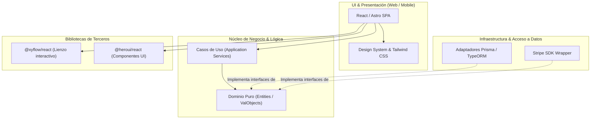

# Vista de Desarrollo (Development / Implementation View)

La **Vista de Desarrollo** (también conocida como *Vista de Implementación*) describe la organización estática de los artefactos de software dentro del entorno de desarrollo. Se concentra en cómo el código fuente está dividido en módulos, paquetes, bibliotecas, capas y subsistemas, y cómo se gestionan las dependencias entre ellos durante el proceso de construcción (*build*).

---

## 1. Propósito y Audiencia

- **Audiencia:** Desarrolladores de software, líderes técnicos, ingenieros de QA y gestores de configuración (*Release Managers*).
- **Pregunta central:** *¿Cómo está organizado el software para ser construido, probado y mantenido por los equipos de ingeniería? ¿Qué dependencias existen entre los módulos de código?*
- **Foco:** Facilidad de desarrollo, reutilización de código, gestión de dependencias, límites de módulos, asignación de tareas a equipos y gobernanza de la base de código.

---

## 2. Elementos Clave de la Vista de Desarrollo

A diferencia de la vista lógica (que modela entidades conceptuales y clases ideales), la vista de desarrollo modela **artefactos concretos de software y código**:



### Catálogo de Elementos de Construcción

| Elemento | Estereotipo | Definición | Ejemplo |
| :--- | :--- | :--- | :--- |
| **Módulo (*Module*)** | `<<module>>` | Unidad autónoma de código que encapsula funcionalidad y expone una API pública limpia. | `auth-module`, `billing-engine` |
| **Paquete (*Package / Namespace*)** | `<<package>>` | Mecanismo de agrupación jerárquica de archivos y tipos de código fuente. | `com.empresa.pagos.domain`, `@empresa/core-ui` |
| **Componente de Software** | `<<component>>` | Bloque modular reemplazable que empaqueta una o más funciones o clases bajo un contrato. | `PaymentGatewayClient`, `PDFExporter` |
| **Capa (*Layer*)** | `<<layer>>` | Nivel arquitectónico horizontal que agrupa componentes con responsabilidades afines. | `Presentation Layer`, `Domain Layer`, `Persistence Layer` |
| **Biblioteca Externa (*Library / Dependency*)** | `<<library>>` | Código de terceros integrado mediante gestores de dependencias (npm, Maven, NuGet, Pip, Cargo). | `react`, `zod`, `axios`, `express` |
| **Artefacto Compilado (*Artifact*)** | `<<artifact>>` | Resultado tangible del proceso de compilación y empaquetado. | Archivo `.jar`, bundle `.js`, gema, `.whl`, binario Go |

---

## 3. Principios de Diseño en la Vista de Desarrollo

Para que una base de código sea mantenible, escalable y admita el trabajo concurrente de decenas de ingenieros, la vista de desarrollo debe hacer cumplir principios fundamentales:

### A. Regla de Dependencia Unidireccional (Sin Ciclos)
- Las dependencias entre paquetes o módulos deben formar un **Grafo Acíclico Dirigido (DAG)**.
- **Principio de Dependencias Acíclicas (ADP):** No deben existir ciclos de importación entre paquetes (`A -> B -> C -> A`). Los ciclos destruyen la compilación incremental y dificultan los tests unitarios aislados.

### B. Principio de Inversión de Dependencias (DIP) en el Código
- Los módulos de alto nivel (como la lógica de negocio en `Domain`) **nunca deben importar directamente** a los módulos de bajo nivel (como `SQLDatabase` o librerías de infraestructura).
- En su lugar, el módulo de dominio define interfaces (puertos) y los módulos de infraestructura dependen hacia adentro implementando dichas interfaces.

### C. Estrategias de Empaquetado

1. **Package-by-Layer (Empaquetado por Capas):**
   ```text
   src/
   ├── controllers/
   ├── services/
   ├── repositories/
   └── models/
   ```
   *Adecuado para aplicaciones pequeñas o monolitos simples.*

2. **Package-by-Feature / Component (Empaquetado por Característica / Dominio):**
   ```text
   src/
   ├── checkout/
   │   ├── CheckoutController.ts
   │   ├── CheckoutService.ts
   │   └── OrderRepository.ts
   ├── catalog/
   └── identity/
   ```
   *Altamente recomendado para arquitecturas modulares y preparación hacia microservicios.*

---

## 4. Estructura de Repositorios y CI/CD

La vista de desarrollo moderna incluye la estrategia de control de versiones y compilación:

- **Monorrepo vs Multirrepo:** Cómo se distribuyen los módulos en repositorios Git (ej. herramientas como Turborepo, Nx o Lerna para coordinar builds compartidos).
- **Entorno de Construcción (*Build Pipeline*):**
  - Pasos de compilación: `Linting` $\to$ `Typecheck` $\to$ `Unit Tests` $\to$ `Bundling/Transpiling` $\to$ `Docker Build`.
  - Definición de artefactos finales listos para ser entregados a la Vista Física.

---

## 5. Diagramas Típicos Asociados a la Vista de Desarrollo

1. **Diagramas de Componentes UML:** Muestran los bloques de código, los puertos que exponen (`Provided Interfaces` / *lollipop*) y los puertos que consumen (`Required Interfaces` / *socket*).
2. **Diagramas de Paquetes UML:** Exponen las carpetas principales del proyecto y las relaciones de importación/dependencia entre ellos.
3. **Grafos de Módulos / Dependencias:** Representan la jerarquía de dependencias internas y librerías externas (útil para auditorías de seguridad y *Software Bill of Materials* - SBOM).
