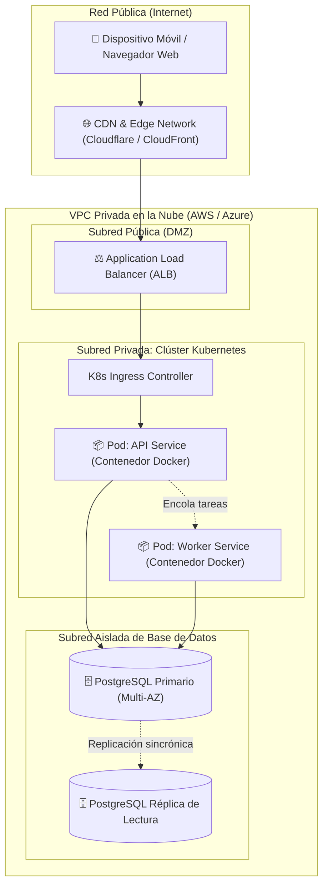

# Vista Física (Physical / Deployment View)

La **Vista Física** (también denominada *Vista de Despliegue*) describe la topología de hardware, infraestructura de nube, redes y plataformas de computación sobre las cuales se ejecuta el software. Mapea directamente los componentes construidos (de la Vista de Desarrollo) y los procesos activos (de la Vista de Procesos) en nodos de cómputo reales o virtualizados.

---

## 1. Propósito y Audiencia

- **Audiencia:** Ingenieros de DevOps, administradores de sistemas (*SysAdmins*), ingenieros de redes, arquitectos Cloud y operadores de infraestructura.
- **Pregunta central:** *¿Dónde y sobre qué infraestructura se ejecuta el software? ¿Cómo están conectados físicamente o mediante redes los diferentes componentes?*
- **Foco:** Requisitos no funcionales de **alta disponibilidad (HA)**, **tolerancia a fallos**, **seguridad perimetral**, **escalabilidad elástica**, **latencia de red** y **ancho de banda**.

---

## 2. Conceptos y Elementos Fundamentales

La vista física traslada el software intangible a servidores, dispositivos y cables de red (o sus equivalentes virtualizados en la nube):

### Catálogo de Elementos de Infraestructura

| Elemento | Estereotipo | Definición | Ejemplo |
| :--- | :--- | :--- | :--- |
| **Nodo Físico (*Hardware Node*)** | `<<device>>` | Servidor físico, máquina *bare-metal* o aparato de hardware dedicado. | Servidor rack Dell PowerEdge, Terminal POS, Raspberry Pi |
| **Máquina Virtual (*Virtual Machine*)** | `<<execution-environment>>` | Instancia de cómputo virtualizada con sistema operativo completo. | Instancia AWS EC2, VM de Azure, Droplet de DigitalOcean |
| **Contenedor / Pod (*Container*)** | `<<container>>` | Entorno de ejecución ligero y aislado a nivel de kernel de SO. | Contenedor Docker, Pod de Kubernetes |
| **Balanceador de Carga (*Load Balancer*)** | `<<load-balancer>>` | Dispositivo de red que distribuye el tráfico entrante entre múltiples nodos. | AWS ALB, NGINX, HAProxy, F5 BIG-IP |
| **Zona de Red / Subred (*Network Zone*)** | `<<network-zone>>` | Segmento de red lógico con políticas de firewall y acceso específicas. | VPC, Subred Pública, Subred Privada, DMZ |
| **Servicio Gestionado Cloud (*PaaS / SaaS*)** | `<<cloud-service>>` | Capacidad de cómputo, almacenamiento o datos administrada por el proveedor. | AWS S3, Google Cloud Spanner, Cloudflare Workers |
| **Enlace de Comunicación (*Network Link*)** | Línea con protocolo | Conexión física o virtual entre dos nodos indicando protocolo y puerto. | `HTTPS (443)`, `gRPC / HTTP/2 (50051)`, `Postgres TCP (5432)` |

---

## 3. Preocupaciones de Despliegue y Alta Disponibilidad

Al modelar la vista física, es imperativo explicitar las decisiones de resiliencia y topología:

### A. Despliegue Multi-Zona y Multi-Región
- **Zonas de Disponibilidad (AZs):** Cómo se replican los servidores en centros de datos físicamente independientes dentro de una misma región para sobrevivir a fallos eléctricos o de inundación.
- **Failover Automático:** Mecanismos de conmutación ante desastres (ej. base de datos primaria conmuta a secundaria en < 30 segundos).

### B. Segmentación de Red y Seguridad Perimetral
- **Principio de Mínimo Privilegio de Red:** Las bases de datos nunca deben colocarse en subredes públicas con IPs asignables a Internet; deben residir en subredes privadas aisladas accesibles únicamente desde los pods o servidores de aplicación autorizados.
- **Terminación SSL/TLS:** En qué nodo se desencripta el tráfico HTTPS (normalmente en el balanceador o en el Ingress controller).

### C. Mapeo de Artefactos a Nodos (*Deployment Mapping*)
En UML, un artefacto de la Vista de Desarrollo (ej. `api-service.jar` o la imagen `registry.io/api:v1.2`) se representa desplegado (*manifestado*) dentro de un nodo físico o contenedor mediante una relación `<<deploy>>` o anidación gráfica.

---

## 4. Diagramas Típicos Asociados a la Vista Física

1. **Diagramas de Despliegue UML:**
   - Representación con nodos cúbicos en 3D que muestran los servidores físicos, las máquinas virtuales y los artefactos desplegados en su interior.
2. **Diagramas de Arquitectura Cloud (Topología de Red):**
   - Diagramas modernos que emplean los iconos oficiales de los proveedores (AWS, Google Cloud, Azure) para detallar VPCs, subredes, grupos de autoescalado (*Auto-Scaling Groups*), puertas de enlace NAT y tablas de rutas.
