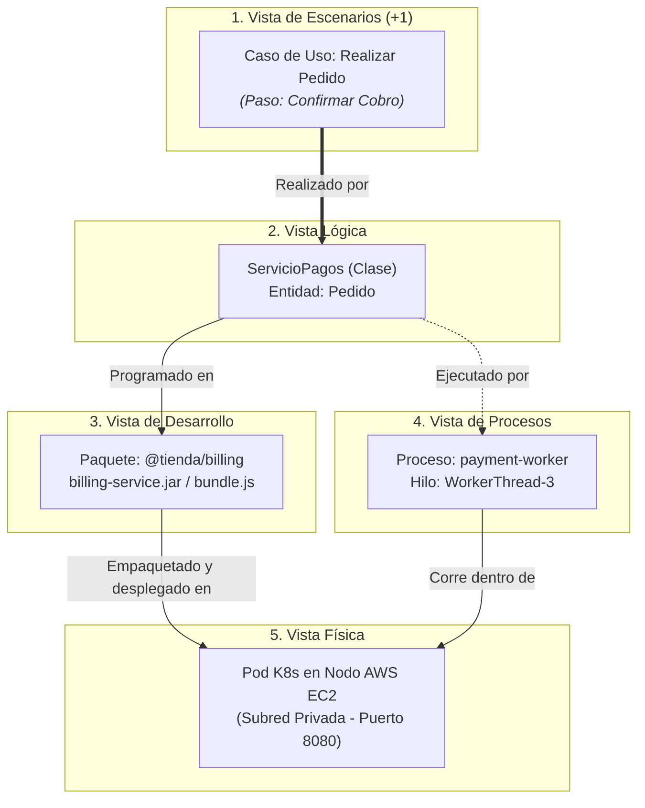

# Trazabilidad y Correspondencia entre las 5 Vistas

El verdadero poder del **Modelo 4+1** no radica únicamente en separar el sistema en cinco vistas, sino en la **coherencia y trazabilidad rigurosa** que existe entre ellas. Las vistas no son silos independientes: describen el mismo sistema desde perspectivas complementarias y deben encajar como las piezas de un rompecabezas.

---

## 1. La Matriz de Correspondencia Arquitectónica

La siguiente matriz define cómo se conectan y traducen los elementos de una vista a otra:

| Desde Vista | Hacia Vista | Relación de Correspondencia | Pregunta de Coherencia |
| :--- | :--- | :--- | :--- |
| **Escenarios (+1)** | **Lógica** | Realización Funcional | *¿Qué clases y servicios colaboran para ejecutar los pasos de este caso de uso?* |
| **Escenarios (+1)** | **Procesos** | Flujo Temporal y Concurrencia | *¿Qué hilos o mensajes asíncronos se disparan cuando el usuario ejecuta este escenario?* |
| **Lógica** | **Desarrollo** | Empaquetado y Modularización | *¿En qué paquete, módulo o archivo de código fuente está programada cada clase lógica?* |
| **Lógica** | **Procesos** | Asignación de Ejecución | *¿Qué proceso o hilo tiene la responsabilidad de ejecutar los métodos de esta entidad o servicio?* |
| **Desarrollo** | **Física** | Despliegue (*Manifestación*) | *¿En qué nodo, servidor o contenedor Docker se instala el binario o paquete compilado?* |
| **Procesos** | **Física** | Alojamiento en Tiempo de Ejecución | *¿En qué CPU o pod de Kubernetes corre este proceso activo y qué puertos de red escucha?* |

---

## 2. Mapa Global de Trazabilidad

---

## 3. Ejemplo Práctico de Extremo a Extremo: "CineNova"

Para ilustrar la coherencia del modelo 4+1, analicemos cómo se desglosa una sola operación arquitectónica crucial: **"Reproducir Película en 4K"** en una plataforma de streaming.

### 1. En la Vista de Escenarios (+1)
- **Caso de Uso:** `Reproducir Video 4K`.
- **Actor:** `Suscriptor Premium`.
- **Flujo:**
  1. El suscriptor solicita reproducción desde su Smart TV.
  2. El sistema valida si la suscripción está activa y admite 4K.
  3. El sistema entrega el manifiesto de reproducción seguro (DRM).
  4. La aplicación comienza a descargar y decodificar los fragmentos de video.

### 2. En la Vista Lógica
- **Clases y Entidades involucradas:**
  - `CatalogoVideo`: Administra las películas y metadatos de resolución.
  - `GestorLicenciasDRM`: Emite las llaves criptográficas de descifrado.
  - `ServicioStreaming`: Orquesta la sesión de reproducción y las cuotas de concurrencia.
  - `PerfilUsuario`: Entidad con los privilegios del plan contratado.

### 3. En la Vista de Desarrollo
- **Módulos y Código fuente:**
  - Módulo `@cinenova/drm-service`: Implementado en Go para máximo rendimiento criptográfico.
  - Módulo `@cinenova/video-catalog`: Microservicio NestJS/TypeScript.
  - Biblioteca compartida `@cinenova/auth-sdk`: Utilizada por ambos módulos para verificar tokens JWT.

### 4. En la Vista de Procesos
- **Entidades de Ejecución:**
  - `drm-engine-process`: Proceso binario nativo Go multihilo con 16 workers dedicados a la generación de tokens DRM.
  - `telemetry-stream`: Tubería asíncrona Kafka donde el reproductor envía eventos de buffering cada 5 segundos sin bloquear la UI.

### 5. En la Vista Física
- **Topología de Despliegue:**
  - **Cliente:** Smart TV ejecutando la app web/native.
  - **CDN Perimetral:** Cloudflare CDN con nodos Edge ubicados a menos de 20ms de la ciudad del usuario para servir los fragmentos de video (HLS/DASH).
  - **Clúster Kubernetes en AWS (us-east-1):**
    - Subred Privada: Pods de `drm-engine` ejecutándose en instancias optimizadas para computación (`c6g.xlarge`).
    - Base de Datos DynamoDB globalmente replicada para verificar el estado de la suscripción en sub-milisegundos.

---

## 4. Lista de Comprobación de Coherencia Arquitectónica (*Integrity Checklist*)

Antes de dar por concluida la documentación de una arquitectura con el modelo 4+1, el equipo debe verificar:

- [ ] **Sin Huérfanos Lógicos:** ¿Cada clase o módulo lógico se utiliza en al menos un escenario de negocio relevante?
- [ ] **Sin Procesos Fantasma:** ¿Cada proceso o hilo modelado en la Vista de Procesos aloja código especificado en la Vista de Desarrollo?
- [ ] **Sin Artefactos Flotantes:** ¿Cada binario o paquete de la Vista de Desarrollo tiene un nodo o contenedor de destino explícito en la Vista Física?
- [ ] **Sin Conexiones Invisibles:** Si dos procesos dialogan en la Vista de Procesos, ¿existe una ruta de red y protocolo correspondiente en la Vista Física?
- [ ] **Cobertura de Requisitos No Funcionales:** ¿Los tiempos de respuesta y tolerancias a fallos exigidos en los Escenarios están respaldados por la redundancia de la Vista Física y los patrones asíncronos de la Vista de Procesos?
