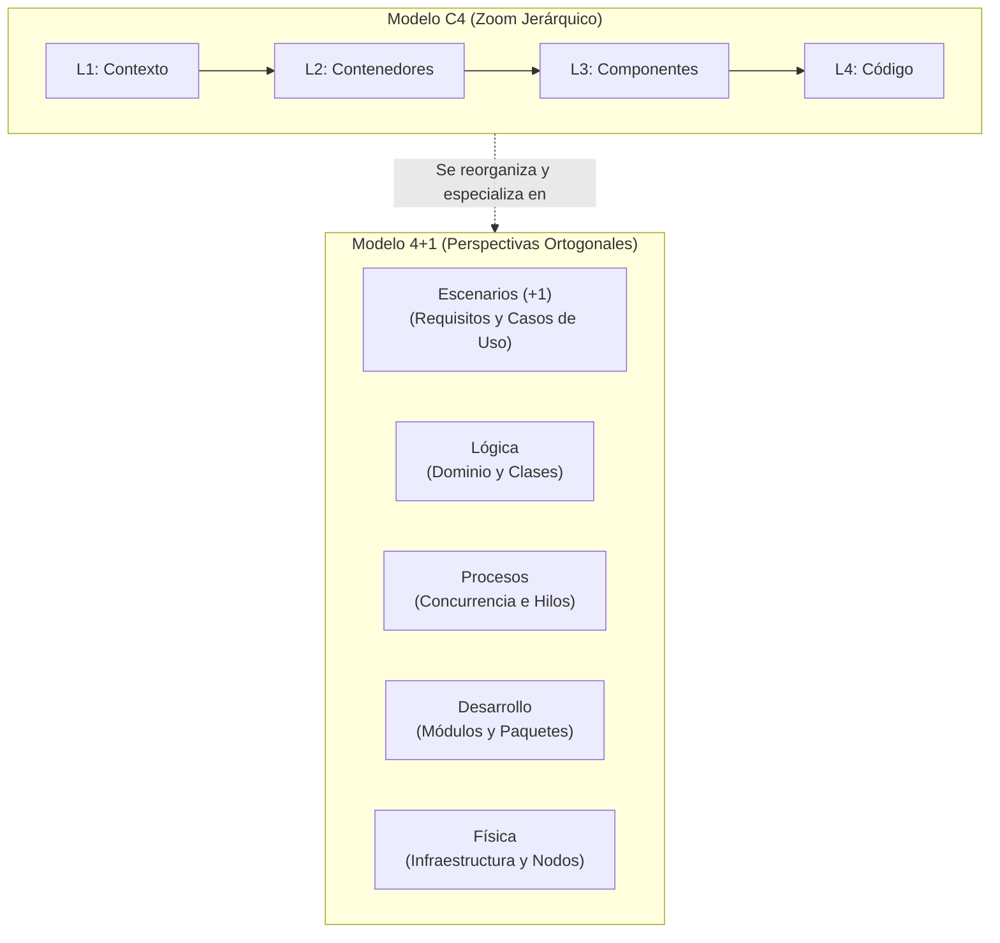
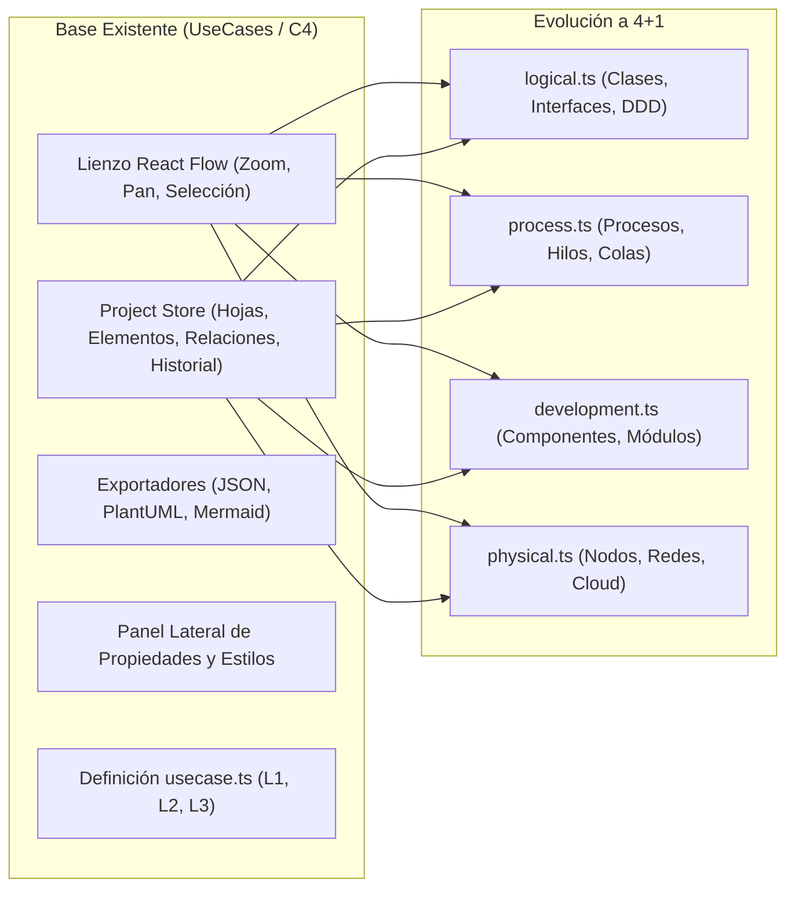

# Comparativa y Transición: Del Modelo C4 al Modelo 4+1

Este documento establece un puente técnico y conceptual exhaustivo entre el **Modelo C4 de Simon Brown** (en el que se basaba originalmente este proyecto) y el **Modelo de Vistas 4+1 de Philippe Kruchten**. Proporciona el mapa de migración exacto para evolucionar la base de código existente hacia el modelador 4+1 completo.

---

## 1. Filosofía de Ambos Modelos: Zoom vs Perspectivas

La diferencia filosófica fundamental entre ambos modelos radica en su eje de descomposición:

- **Modelo C4:** Es un modelo de **zoom jerárquico** (*Scale/Abstraction levels*). Similar a Google Maps, C4 examina el mismo sistema desde muy lejos (Contexto del sistema) hasta muy cerca (Código fuente de clases). Todos los niveles mezclan aspectos lógicos, físicos y de desarrollo en un solo plano.
- **Modelo 4+1:** Es un modelo de **ortogonalidad por puntos de vista** (*Orthogonal Concerns*). Cada vista responde a una pregunta técnica diferente para una audiencia distinta (usuarios, analistas, desarrolladores, integradores, devops).

---

## 2. Tabla Maestra de Correspondencia C4 $\to$ 4+1

| Nivel C4 | Elementos en C4 | Cómo se mapea en el Modelo 4+1 | En qué vista de 4+1 vive |
| :--- | :--- | :--- | :--- |
| **L1: Contexto** | Personas, Sistemas de software, Sistemas externos | - Actores y Límites del sistema - Diagramas de contexto de casos de uso | **Vista de Escenarios (+1)** |
| **L2: Contenedores** | Aplicaciones web, APIs backend, Bases de datos, Colas | - **Como ejecutables:** Procesos y servicios en ejecución - **Como código:** Módulos de despliegue y artefactos compilados - **Como infraestructura:** Servidores, VMs o Pods donde residen | **Vista de Procesos** (hilos/procesos) **Vista de Desarrollo** (artefactos/apps) **Vista Física** (servidores/nodos) |
| **L3: Componentes** | Controladores, Servicios de aplicación, Repositorios | - Módulos de código fuente, paquetes y bibliotecas internas - Subsistemas lógicos y contratos de interfaces | **Vista de Desarrollo** (paquetes/componentes) **Vista Lógica** (subsistemas) |
| **L4: Código** | Clases, Interfaces, Métodos, Inyección de dependencias | - Clases, entidades de dominio, patrones de diseño y máquinas de estado | **Vista Lógica** (modelo de clases/dominio) **Vista de Desarrollo** (archivos `.ts`, `.java`) |

---

## 3. ¿Qué aporta el Modelo 4+1 que no cubría C4?

Al transicionar de C4 a 4+1, la plataforma adquiere capacidades de modelado de mucho mayor rigor arquitectónico:

1. **Tratamiento Formal de la Concurrencia (Vista de Procesos):**
   - En C4, una cola o un servicio solo se señalan como una caja "contenedor".
   - En 4+1, se modela explícitamente el hilo de ejecución, la sincronización, los bloqueos, las transiciones asíncronas y los pools de workers.
2. **Despliegue Físico y Topología de Red Real (Vista Física):**
   - En C4, el concepto de "contenedor" confunde frecuentemente el software ejecutable con la máquina que lo aloja.
   - En 4+1, la vista física distingue con claridad entre la máquina virtual, el rack, el balanceador de carga, la VPC, la subred y el contenedor Docker.
3. **Formalización de Requisitos y Flujos (Vista de Escenarios +1):**
   - En C4 no hay un estándar nativo para modelar los pasos de un caso de uso, precondiciones o relaciones `<<include>>` / `<<extend>>`.
   - En 4+1, los casos de uso dirigen la arquitectura y sirven de criterio de aceptación.
4. **Organización de Código y Módulos de Compilación (Vista de Desarrollo):**
   - En C4, el foco del nivel 3 son los componentes en tiempo de ejecución.
   - En 4+1, la vista de desarrollo aborda dependencias de build, monorrepos, bibliotecas compartidas y empaquetado.

---

## 4. Estrategia de Aprovechamiento del Código Existente

Dado que este repositorio ya cuenta con un motor maduro (Astro + React + `@xyflow/react` + Zustand/Store + Exportadores), la evolución hacia 4+1 se realiza de forma natural y limpia:

### Componentes Inmediatamente Reutilizables
1. **Lienzo Gráfico (`Canvas.tsx`):** El motor de arrastre, conexión de puertos (`handles`), zoom, autolayout y atajos de teclado funciona de manera idéntica para todas las vistas.
2. **Store de Proyecto (`project-store.tsx`):** La estructura jerárquica con `parentId`, hojas (`sheets`) y relaciones ya está lista para soportar múltiples vistas.
3. **Inspector y Sistema de Estilos (`Inspector.tsx`):** Los controles de colores, opacidad, bordes, etiquetas y metadatos se adaptan según el tipo de elemento activo.
4. **Exportadores (`exporters.ts`):** Ya generan sintaxis limpia de Mermaid y PlantUML, que soportan nativamente diagramas de clases, componentes, secuencia y despliegue.

### Adaptaciones Requeridas en la Base de Código
1. **Tipos de Diagrama (`src/lib/types.ts`):**
   - Extender `DiagramId` de `"usecase"` a `"usecase" | "logical" | "process" | "development" | "physical"`.
2. **Definiciones de Vistas (`src/lib/diagrams/`):**
   - Crear los archivos de configuración descriptiva para cada una de las 4 vistas técnicas pendientes.
3. **Nuevos Tipos de Nodos y Formas:**
   - Incorporar formas específicas (nodo de clase con compartimentos de atributos/métodos, nodo cúbico de despliegue, nodo de componente con puerto *lollipop*).
