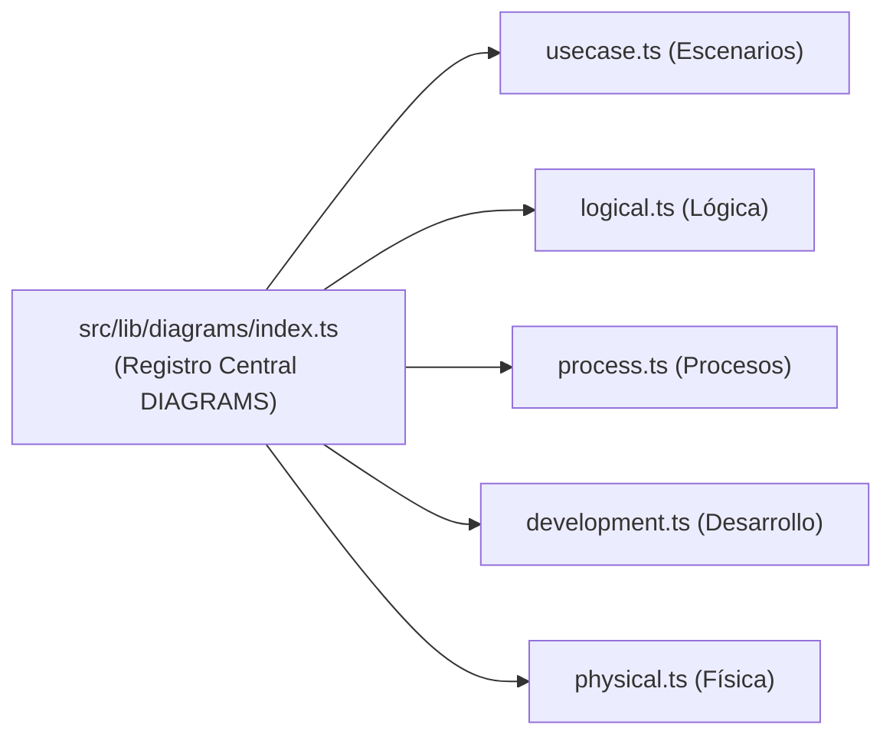

# Guía Técnica de Implementación del Modelador 4+1

Este documento establece la **especificación técnica de arquitectura de software interna** para implementar las cinco vistas completas del Modelo 4+1 sobre el proyecto actual (construido con Astro, React 19, TypeScript, Tailwind CSS, HeroUI y `@xyflow/react`).

---

## 1. Arquitectura del Modelo de Datos (`src/lib/types.ts`)

Para soportar las cinco vistas con navegación por hojas (*sheets*), jerarquía de niveles y relaciones especializadas, los tipos de TypeScript deben estructurarse de la siguiente manera:

### A. Identificadores de Vista (`DiagramId`)
```typescript
export type DiagramId =
  | "usecase"      // Vista de Escenarios (+1)
  | "logical"      // Vista Lógica
  | "process"      // Vista de Procesos
  | "development"  // Vista de Desarrollo
  | "physical";    // Vista Física
```

### B. Catálogo Exhaustivo de Elementos (`ElementKind`)
```typescript
export type ElementKind =
  // --- Vista de Escenarios (+1) ---
  | "actor" | "system" | "useCase" | "step"
  // --- Vista Lógica ---
  | "class" | "interface" | "subsystem" | "domainEntity" | "valueObject" | "service"
  // --- Vista de Procesos ---
  | "process" | "thread" | "queue" | "eventStream" | "task"
  // --- Vista de Desarrollo ---
  | "module" | "component" | "package" | "layer" | "library" | "artifact"
  // --- Vista Física ---
  | "node" | "device" | "virtualMachine" | "container" | "loadBalancer" | "networkZone" | "cloudService"
  // --- Universal ---
  | "note";
```

### C. Catálogo de Estilos de Relaciones (`RelationshipStyle`)
```typescript
export type RelationshipStyle =
  // Casos de uso
  | "association" | "include" | "extend" | "generalization"
  // Lógica y Desarrollo
  | "dependency" | "realization" | "aggregation" | "composition"
  // Procesos y Redes
  | "syncCall" | "asyncMessage" | "stream"
  // Física / Despliegue
  | "deployOn" | "networkLink";
```

---

## 2. Especificación de las 5 Vistas en `src/lib/diagrams/`

Cada vista se registra como un `DiagramDef` con sus propios niveles (*levels*), tipos de nodo (*kinds*), formas visuales (*shapes*), paleta de colores y reglas de *drill-down*.



### 1. Vista de Escenarios (`usecase.ts` - Ya implementada)
- **Nivel L1 (Actores y Sistemas):** `actor`, `system`, `note`.
- **Nivel L2 (Casos de Uso):** `useCase`, `note` (dentro de un `system`).
- **Nivel L3 (Flujo de Pasos):** `step`, `note` (dentro de un `useCase`).

### 2. Vista Lógica (`logical.ts`)
- **Nivel L1 (Subsistemas y Paquetes de Dominio):**
  - Kinds: `subsystem`, `package`, `note`.
  - Drill-down: Al hacer doble clic en un `subsystem`, baja a L2.
- **Nivel L2 (Clases y Entidades del Dominio):**
  - Kinds: `class`, `interface`, `domainEntity`, `valueObject`, `service`, `note`.
  - Atributos específicos en `meta`: `attributes` (lista de campos tipados), `methods` (lista de firmas), `visibility`.
- **Nivel L3 (Máquina de Estados de Entidad):**
  - Kinds: `step` / estados para modelar el ciclo de vida de una entidad.

### 3. Vista de Procesos (`process.ts`)
- **Nivel L1 (Topología de Ejecución):**
  - Kinds: `process`, `queue`, `eventStream`, `note`.
  - Relaciones: `syncCall` (línea continua con flecha), `asyncMessage` (discontinua animada), `stream` (doble flecha continua).
- **Nivel L2 (Concurrencia Interna de Proceso):**
  - Kinds: `thread`, `task`, `eventStream`, `note` (dentro de un `process`).

### 4. Vista de Desarrollo (`development.ts`)
- **Nivel L1 (Capas y Módulos de Alto Nivel):**
  - Kinds: `layer`, `module`, `library`, `note`.
- **Nivel L2 (Componentes y Paquetes de Código):**
  - Kinds: `component`, `package`, `artifact`, `note`.
  - Relaciones: `dependency`, `realization`, `composition`.

### 5. Vista Física (`physical.ts`)
- **Nivel L1 (Topología de Redes y Zonas Cloud):**
  - Kinds: `networkZone` (VPC/Subred), `node`, `device`, `cloudService`, `note`.
- **Nivel L2 (Nodos de Cómputo y Contenedores):**
  - Kinds: `virtualMachine`, `container`, `loadBalancer`, `note` (dentro de un `node` o `networkZone`).
  - Relaciones: `deployOn` (contención o anidación), `networkLink` (con metadatos de puerto y protocolo).

---

## 3. Renderizado de Nodos Especializados en React Flow

Actualmente el lienzo utiliza nodos genéricos (`DiagramElementNode`) con soporte para formas rectangulares, circulares y de persona. Para el soporte integral de 4+1, se añaden las siguientes formas en `NodeShape`:

| Forma (`NodeShape`) | Vista Destino | Aspecto Gráfico | Contenido |
| :--- | :--- | :--- | :--- |
| `class-box` | Lógica | Rectángulo con 3 compartimentos divididos por líneas horizontales. | 1: Nombre y estereotipo<br/>2: Atributos (`+ id: UUID`)<br/>3: Métodos (`+ procesar(): void`) |
| `component-box` | Desarrollo | Rectángulo con el símbolo clásico de componente (dos pequeños rectángulos a la izquierda) y puerto *lollipop*. | Nombre del componente y bibliotecas empaquetadas. |
| `cube` | Física | Caja en perspectiva isométrica o 3D pseudorrealista. | Nombre del servidor, IP, especificaciones (CPU/RAM). |
| `queue-cylinder` | Procesos | Cilindro horizontal o tubería con ondas. | Nombre de la cola/tópico y capacidad. |
| `boundary-zone` | Física / Lógica | Caja contenedora transparente con línea discontinua y cabecera de título. | Subred VPC o límite de subsistema. |

---

## 4. Estrategia de Exportación (`src/lib/exporters.ts`)

El exportador del proyecto debe reconocer la vista activa de la hoja (`sheet.diagram`) y generar la sintaxis adecuada:

### A. Para PlantUML
- `usecase` $\to$ `@startuml` con sintaxis `actor`, `usecase`, `-->`, `..> : <<include>>`.
- `logical` $\to$ `@startuml` con sintaxis `class`, `interface`, `--|>`, `*--`, `o--`.
- `process` $\to$ `@startuml` con sintaxis de componentes/procesos o diagramas de secuencia (`actor`, `participant`, `->`, `->>`).
- `development` $\to$ `@startuml` con sintaxis `component [Nombre]`, `package { ... }`.
- `physical` $\to$ `@startuml` con sintaxis `node "Servidor"`, `cloud "AWS"`, `database "DB"`.

### B. Para Mermaid
- `usecase` $\to$ `flowchart LR` o `sequenceDiagram`.
- `logical` $\to$ `classDiagram`.
- `process` $\to$ `sequenceDiagram` o `flowchart LR` con líneas discontinuas animadas (`-.->`).
- `development` $\to$ `flowchart TD` con subgrafos jerárquicos.
- `physical` $\to$ `flowchart TB` con subgrafos para VPCs/Subredes y nodos de infraestructura.

---

## 5. Hoja de Ruta de Implementación Sugerida

1. **Fase 1: Preparación de Tipos y Registro:**
   - Habilitar los 5 valores en `DiagramId` y ampliar `ElementKind` y `RelationshipStyle`.
   - Modificar el menú «+» en `SheetTabs.tsx` para permitir crear hojas de cualquiera de las 5 vistas.
2. **Fase 2: Implementación de la Vista Lógica (`logical.ts`):**
   - Incorporar el editor de atributos y métodos en el `Inspector.tsx`.
   - Renderizar el nodo `class-box` con compartimentos.
3. **Fase 3: Implementación de la Vista Física (`physical.ts`):**
   - Añadir nodo cúbico y contenedor de zona de red/VPC.
   - Habilitar metadatos de puerto y protocolo en las relaciones.
4. **Fase 4: Implementación de la Vista de Procesos (`process.ts`):**
   - Soporte para colas, hilos y tipos de enlace síncrono/asíncrono con animación visual de flujo.
5. **Fase 5: Implementación de la Vista de Desarrollo (`development.ts`):**
   - Paquetes, capas y componentes modulares.
6. **Fase 6: Catálogo de Ejemplos 4+1:**
   - Adaptar los 50 casos de estudio para que presenten pestañas con las vistas correspondientes según su nivel de complejidad.
