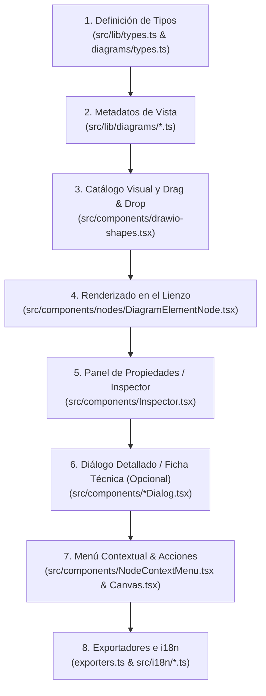

# Guía de Análisis e Implementación de Nuevos Items en el Modelador 4+1

> **Audiencia:** Agentes de Inteligencia Artificial (IA) y desarrolladores de software.  
> **Objetivo:** Establecer la arquitectura, estándares, flujo de trabajo paso a paso y lista de verificación exhaustiva para crear, analizar e integrar nuevos elementos visuales (*items / shapes / element kinds*), relaciones y fichas técnicas dentro del Modelador 4+1.

---

## 1. Visión General de la Arquitectura de Elementos

El modelador utiliza una arquitectura reactiva construida sobre **Astro**, **React 19**, **TypeScript**, **Tailwind CSS v4**, **HeroUI** y **@xyflow/react** (React Flow).

Cada elemento visual del lienzo es una instancia de `DiagramElement` dentro de una hoja (`Sheet`). Su comportamiento, apariencia, inspector y opciones se derivan de su **`kind`** (`ElementKind`) y su **`shape`** (`NodeShape`).



---

## 2. Metodología de Análisis Previo para Nuevos Items

Antes de escribir código para un nuevo item, la IA o el desarrollador debe responder estas 6 preguntas de análisis:

| # | Pregunta de Análisis | Opciones / Criterios |
| :--- | :--- | :--- |
| **1** | **¿A qué vista del Modelo 4+1 pertenece?** | - **Escenarios (+1):** Actores, Casos de Uso, CU Detallado, Pasos.<br/>- **Lógica:** Clases, Interfaces, Subsistemas, Entidades de Dominio.<br/>- **Procesos:** Hilos (*threads*), Colas (*queues*), Event Streams.<br/>- **Desarrollo:** Componentes, Módulos, Capas (*layers*), Paquetes.<br/>- **Física:** Servidores/Nodos, VMs, Contenedores, Balanceadores.<br/>- **Universal / General:** Formas geométricas estilo Draw.io, Notas. |
| **2** | **¿A qué nivel de profundidad pertenece?** | - `depth: 0` (Nivel raíz o externo, visible en L1).<br/>- `depth: 1` (Nivel intermedio, e.g. casos de uso dentro del sistema).<br/>- `depth: 2` (Nivel granular, e.g. pasos dentro de un caso de uso). |
| **3** | **¿Es perforable (*drillable*) con doble clic?** | - `true`: Al hacer doble clic baja a un subnivel (ej: de Sistema a Casos de uso).<br/>- `false`: Abre un modal/ficha o es un nodo terminal. |
| **4** | **¿Tiene una forma visual estándar o personalizada?** | - Estándar: Rectángulo, elipse, cilindro, nube, etc.<br/>- Personalizada: Libro/CU detallado, personaje stickman, ventana, etc. |
| **5** | **¿Requiere atributos específicos en `meta`?** | - `element.meta` almacena pares clave-valor tipo `Record<string, string>`. Para datos complejos se almacena como JSON serializado (`JSON.stringify`). |
| **6** | **¿Requiere una Ficha Técnica o Diálogo Dedicado?** | Si recopila documentación extensa (ej: plantilla Cockburn/RUP, contratos de API, especificación de cola), debe contar con su propio componente modal. |

---

## 3. Checklist de Archivos a Modificar (Paso a Paso)

Para incorporar cualquier item nuevo de forma completa y sin errores, se debe seguir estrictamente este orden:

### Paso 1: Registrar el `ElementKind` (`src/lib/types.ts`)
Añadir el identificador literal al tipo `ElementKind`:
```typescript
// src/lib/types.ts
export type ElementKind =
  // ...
  | "useCase"
  | "detailedUseCase" // <-- Nuevo elemento
  | "step"
  // ...
```

### Paso 2: Registrar el `NodeShape` si tiene forma única (`src/lib/diagrams/types.ts`)
Si el nuevo elemento utiliza una representación gráfica personalizada que no existe en el catálogo de Draw.io, añadirlo a `NodeShape`:
```typescript
// src/lib/diagrams/types.ts
export type NodeShape =
  | "ellipse"
  | "system"
  | "detailedUseCase" // <-- Nueva forma gráfica
  | "classBox";
```

### Paso 3: Configurar los Metadatos del Diagrama
1. **En la vista correspondiente** (ej. `src/lib/diagrams/usecase.ts`):
   - Añadir el `kind` a la lista `kinds` del nivel adecuado en `LEVELS`.
   - Definir su objeto `KindMeta` en `KINDS`:
     ```typescript
     detailedUseCase: {
       kind: "detailedUseCase",
       label: "CU Detallado",
       stereotype: "CU Detallado",
       level: "actors",
       depth: 0,
       bg: "#ffffff",
       border: "#d97706",
       fg: "#0f172a",
       stereo: "#b45309",
       radius: "12px",
       shape: "detailedUseCase",
       icon: "book",
       drillable: false,
       size: { width: 230, height: 110 },
     },
     ```
2. **En el catálogo universal** (`src/lib/diagrams/index.ts`):
   - Registrar la entrada en `GENERAL_KINDS` para garantizar renderizado seguro en cualquier vista.

### Paso 4: Añadir al Catálogo Lateral y Drag & Drop (`src/components/drawio-shapes.tsx`)
Añadir el item en la lista correspondiente (`FOUR_PLUS_ONE_SHAPES` o `GENERAL_SHAPES`):
- `kind`: el `ElementKind` registrado.
- `name`: nombre visible en el catálogo.
- `tooltip`: descripción de ayuda.
- `icon`: icono vectorial SVG representativo (40x40 viewBox).
- `extra`: valores iniciales sugeridos (`name`, `description`, `icon`, `meta` predeterminado).

### Paso 5: Implementar el Renderizado Visual (`src/components/nodes/DiagramElementNode.tsx`)
Agregar la rama correspondiente para el renderizado:
```tsx
// src/components/nodes/DiagramElementNode.tsx
if (meta.shape === "detailedUseCase" || element.kind === "detailedUseCase") {
  return (
    <>
      <div className={[...classes, "clases-tailwind-del-nodo"].join(" ")} style={{ ...computedStyle, ...boxStyle }}>
        <SideHandles sides={["top", "right", "bottom", "left"]} show={showHandles} />
        {/* Contenido visual: Cabecera, icono, badges, datos clave */}
      </div>
      {resizer}
    </>
  );
}
```
*Reglas de oro:*
- Incluir siempre `<SideHandles ... />` para permitir que el usuario conecte flechas/relaciones desde y hacia el nodo.
- Incluir `{resizer}` para permitir redimensionamiento dinámico con `NodeResizer`.
- Respetar `computedStyle` y `boxStyle` para permitir sobreescritura de colores, fuentes y bordes desde el Inspector.

### Paso 6: Crear el Diálogo / Modal de Ficha Técnica (si aplica)
Si el item documenta información estructurada, crear un componente en `src/components/<Nombre>Dialog.tsx`:
- Usar componentes de HeroUI (`Modal`, `Modal.Container`, `Modal.Dialog`, `Modal.Header`, `Modal.Body`, `Modal.Footer`).
- Soportar dos modos si es conveniente: **Edición (Formulario)** y **Previsualización Formal (Tabla/Ficha)**.
- Proveer opciones para **Copiar Markdown** e **Imprimir**.
- Proporcionar botón para guardar actualizando el elemento vía `updateElement(element.id, { ... })`.

### Paso 7: Integración con el Canvas y Doble Clic (`src/components/Canvas.tsx`)
1. En `onNodeDoubleClick`: detectar el `element.kind` y abrir el modal o ejecutar la acción deseada:
   ```tsx
   if (data.element.kind === "detailedUseCase") {
     setDetailedModalId(node.id);
     return;
   }
   ```
2. Renderizar el modal condicionalmente al final del Canvas.
3. Escuchar eventos globales con `window.addEventListener("modeler:open-xxx", ...)` para permitir apertura desde el inspector o menús.

### Paso 8: Menú Contextual (`src/components/NodeContextMenu.tsx`)
Añadir acciones de clic derecho para el nuevo item o para interactuar con otros items existentes (ej: *"Abrir Ficha Técnica"*, *"Agrupar en CU Detallado"*).

### Paso 9: Panel Inspector (`src/components/Inspector.tsx`)
En `ElementContentTab`:
- Agregar controles dedicados cuando `element.kind === "<nuevoItem>"`.
- Proveer botones de acceso directo al diálogo/modal.
- Permitir editar los metadatos específicos del item.

### Paso 10: Exportadores e Internacionalización (`exporters.ts` & `src/i18n/`)
1. **Exportación Markdown (`src/lib/exporters.ts`):** Añadir una función de formato markdown que extraiga los campos de `meta` y genere tablas legibles.
2. **i18n:** Añadir `"kind.<nuevoItem>"` en los diccionarios (`en.ts`, `es.ts`, `de.ts`, `fr.ts`, `pt.ts`, `ko.ts`, `zh.ts`).

---

## 4. Patrón de Agrupación de Elementos

Cuando un item agrupa o documenta otros elementos existentes del diagrama (como `detailedUseCase` agrupando casos de uso):

1. **Almacenamiento:** Guardar la lista de IDs agrupados en `element.meta.groupedUseCaseIds` como string JSON:
   ```typescript
   JSON.stringify(["el_12345", "el_67890"])
   ```
2. **Sincronización:**
   - Buscar los elementos por ID en `sheet.elements`.
   - Inspeccionar relaciones en `sheet.relationships` para heredar automáticamente actores, dependencias o conexiones.
   - Extraer pasos hijos (`parentId === uc.id`) para prellenar escenarios principales.
3. **Acción Rápida de Agrupación:**
   - Permitir agrupar desde el menú contextual (clic derecho) del elemento origen.
   - Calcular coordenadas relativas (`x + 260, y`) y enlazar con `addRelationship`.

---

## 5. Caso de Estudio: `detailedUseCase`

| Aspecto | Implementación Realizada |
| :--- | :--- |
| **Kind** | `detailedUseCase` |
| **Shape** | `detailedUseCase` (tarjeta con lomo de libro, badges y pie interactivo) |
| **Paleta** | Borde `#d97706` (ámbar primario) o `#9333ea` (púrpura secundario) |
| **Icono** | `"book"` (SVG de libro en Draw.io shapes e Inspector) |
| **Ficha Técnica** | `DetailedUseCaseDialog.tsx` con los 11 campos Cockburn/RUP: Nombre, Actor Principal, Intereses, Precondiciones, Postcondiciones, Flujo Básico, Extensiones, Requisitos Especiales, Variaciones de Tecnología, Frecuencia y Temas Abiertos. |
| **Clasificación** | Primario vs Secundario (con enlace directo al CU padre si es secundario). |
| **Agrupación** | Selector de casos de uso del diagrama + botón ⚡ de sincronización automática. |
| **Exportación** | Tabla Markdown completa en `exportMarkdown`. |

---

## 6. Lista de Verificación Rápida para la IA

Antes de dar por completado cualquier nuevo item, verificar:
- [ ] ¿Compila TypeScript sin errores de tipos?
- [ ] ¿Se encuentra el elemento en el catálogo lateral izquierdo con icono visible?
- [ ] ¿Se puede arrastrar y soltar en el lienzo con tamaño adecuado?
- [ ] ¿Tiene handles en los cuatro lados para permitir relaciones bidireccionales?
- [ ] ¿Es redimensionable si el usuario lo requiere?
- [ ] ¿Responde al doble clic de forma intuitiva?
- [ ] ¿Aparecen sus campos en el panel lateral derecho (Inspector)?
- [ ] ¿Tiene opciones en el menú contextual de clic derecho?
- [ ] ¿Se exporta limpiamente a JSON y Markdown?
- [ ] ¿Están todas las claves i18n sincronizadas en los 7 idiomas soportados?
