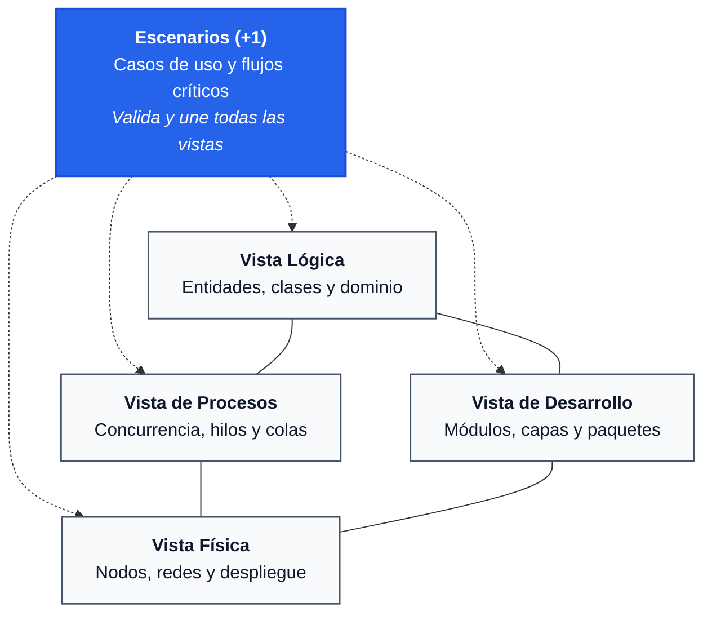

# Centro de Documentación: Modelo de Vistas 4+1

Bienvenido al centro de conocimiento y especificación técnica del **Modelo de Vistas 4+1 de Philippe Kruchten**. Este repositorio contiene todo lo necesario para comprender la metodología arquitectónica, diseñar sistemas reales con ella y desarrollar la aplicación **4+1 Modeler** sobre la base tecnológica existente.

---

## Índice Maestro de la Documentación

La documentación se organiza de forma modular y progresiva en los siguientes documentos:

### 1. Teoría y Fundamentos
- **[01. Fundamentos del Modelo 4+1](01_FUNDAMENTOS_MODELO_4_PLUS_1.md)**
  - Origen histórico (Philippe Kruchten, 1995) y estándar IEEE 1471 / ISO 42010.
  - El problema de intentar representar la arquitectura en un solo plano.
  - Matriz de interesados (*stakeholders*), puntos de vista y preocupaciones no funcionales.
  - Por qué el «+1» no es una vista ortogonal más, sino el pegamento unificador.

### 2. Las Cinco Vistas en Profundidad
- **[02. Vista de Escenarios (+1 View)](02_VISTA_DE_ESCENARIOS.md)**
  - Actores primarios, secundarios y límites del sistema (*boundaries*).
  - Casos de uso arquitectónicamente significativos (ASUC).
  - Flujos detallados (camino feliz, alternativas y excepciones).
  - Relaciones UML (`<<include>>`, `<<extend>>`, generalización).
  - Jerarquía multinivel del editor (*Drill-down*: L1 Actores $\to$ L2 Casos de Uso $\to$ L3 Flujos).

- **[03. Vista Lógica (Logical View)](03_VISTA_LOGICA.md)**
  - Descomposición funcional y modelo conceptual del dominio (DDD).
  - Clases, interfaces, entidades, objetos de valor y subsistemas.
  - Semántica de relaciones: asociación, agregación, composición y herencia.
  - Patrones lógicos: Arquitectura por Capas y Arquitectura Hexagonal (*Clean Architecture*).

- **[04. Vista de Procesos (Process View)](04_VISTA_DE_PROCESOS.md)**
  - Comportamiento en tiempo de ejecución, concurrencia y paralelismo.
  - Procesos pesados, hilos de ejecución (*threads*), workers y bucles de eventos (*event loops*).
  - Modelos de comunicación: Síncrono (REST, gRPC) vs Asíncrono (Pub/Sub, Colas, Streaming).
  - Manejo de condiciones de carrera, bloqueos (*deadlocks*), latencia y *backpressure*.

- **[05. Vista de Desarrollo (Development View)](05_VISTA_DE_DESARROLLO.md)**
  - Organización del código fuente, módulos, paquetes y bibliotecas.
  - Principios de diseño estático: Acoplamiento débil, cohesión y grafo acíclico (ADP / DIP).
  - Estrategias de empaquetado (*package-by-layer* vs *package-by-feature*) y monorrepos.
  - Relación con el ciclo de integración continua (CI/CD) y artefactos compilados.

- **[06. Vista Física (Physical / Deployment View)](06_VISTA_FISICA.md)**
  - Topología de hardware, infraestructura en la nube, servidores y redes.
  - Dispositivos cliente, balanceadores de carga, clústeres Kubernetes y pods Docker.
  - Zonas de red, VPCs, subredes públicas/privadas y seguridad perimetral.
  - Alta disponibilidad (Multi-AZ), replicación de datos y balanceo de tráfico.

### 3. Integración, Migración e Implementación
- **[07. Trazabilidad y Correspondencia entre Vistas](07_TRAZABILIDAD_Y_CORRESPONDENCIA_ENTRE_VISTAS.md)**
  - Matriz de correspondencia cruzada: cómo un elemento de una vista se manifiesta en las otras.
  - Recorrido práctico paso a paso de un caso real (*CineNova: Streaming 4K* a través de las 5 vistas).
  - Lista de comprobación de integridad y coherencia arquitectónica.

- **[08. Comparativa y Transición de C4 a 4+1](08_COMPARATIVA_Y_TRANSICION_C4_A_4_PLUS_1.md)**
  - Comparación de paradigmas: Zoom jerárquico (C4) vs Perspectivas ortogonales (4+1).
  - Mapeo exacto de los niveles C4 (Contexto, Contenedores, Componentes, Código) hacia las 5 vistas.
  - Identificación de componentes y lógica reutilizables de la base de código previa.
  - Qué capacidades nuevas se desbloquean al migrar a 4+1.

- **[09. Guía Técnica de Implementación del Modelador](09_GUIA_TECNICA_PARA_EL_MODELADOR_4_PLUS_1.md)**
  - Especificación técnica del modelo TypeScript (`DiagramId`, `ElementKind`, `RelationshipStyle`).
  - Catálogo de formas de nodo para React Flow (`NodeShape`: clases con compartimentos, cubos de nodo, cilindros de colas, etc.).
  - Estrategia de exportación multiformato (PlantUML, Mermaid, JSON, SVG).
  - Hoja de ruta por fases para implementar los editores restantes en la aplicación.

- **[10. Guía de Creación y Análisis de Nuevos Items para IA](10_GUIA_CREACION_Y_ANALISIS_NUEVOS_ITEMS_AI.md)**
  - Metodología completa de análisis previo antes de codificar nuevos elementos.
  - Checklist exhaustivo de los 10 archivos a modificar en cada nuevo item.
  - Patrón de agrupación, fichas técnicas modales y sincronización de datos.
  - Caso de estudio detallado: Elemento `detailedUseCase` (Cockburn/RUP).

---

## Documentación de Referencia y Catálogo Previo

- **[Guía de Parámetros de URL (URL_PARAMETERS.md)](URL_PARAMETERS.md):** Especificación de parámetros soportados (`?code=`, `?lang=`, `?theme=`, `?share=`, `?edit=`).
- **[Catálogo de Casos de Estudio Previos (examples_README.md)](examples_README.md):** Registro de los 50 proyectos de ejemplo procedentes del modelo anterior.

---

## Resumen Rápido: Las 5 Vistas de un Vistazo

| Vista | ¿Qué describe? | Stakeholder Principal | Notación Habitual |
| :--- | :--- | :--- | :--- |
| **Escenarios (+1)** | Casos de uso y flujos que ilustran y validan el sistema | Usuarios, Product Owners, Arquitectos | Casos de uso UML, Diagramas de flujo |
| **Lógica** | Entidades conceptuales, dominio y estructura de clases | Analistas de negocio, Diseñadores | Diagramas de clases y paquetes |
| **Procesos** | Hilos, tareas, colas, concurrencia y rendimiento | Integradores, Desarrolladores backend | Diagramas de secuencia y actividad |
| **Desarrollo** | Módulos de código, capas, dependencias y librerías | Desarrolladores, Gestores de build | Diagramas de componentes y paquetes |
| **Física** | Servidores, redes, contenedores y topología de nube | DevOps, SysAdmins, Arquitectos Cloud | Diagramas de despliegue y topología de red |
